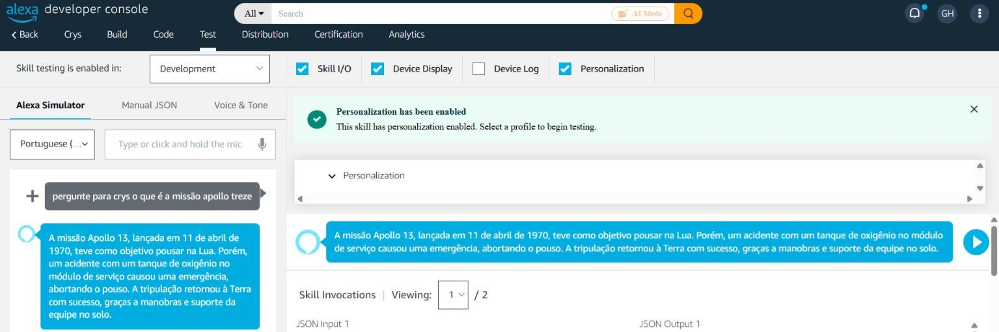

# Crys and Alexa

> “Ask Crys what the Apollo thirteen mission is.”

*Alexa simulator test from November 3, 2026. The crop retains the question and response while excluding account and skill identifiers.*

[Português](README.md) · [Portfolio](https://github.com/EagleKhan0505)

With Crys, I want to talk to an AI assistant through Alexa in Portuguese. I connected a custom Alexa skill to the OpenAI API: Alexa receives the request, the integration handles it and the answer returns through Alexa's interaction flow.

## When the answer has to be spoken

A voice conversation has its own pace. Long answers are difficult to follow, and a slow request can exceed Alexa's response window. The implementation addresses those constraints with concise-response instructions, a short conversation context and request-time controls.

The flow uses the **Responses API**, including web search when needed. Spoken answers prioritize brevity, while sources can appear in the Alexa card for later consultation.

## What the evidence shows

The capture shows a direct Apollo 13 question receiving a response in the simulator. Development records also include opening the skill and an Artemis query with web search and sources.

These are Alexa development-environment tests. Reliable operation on a physical Echo is not yet confirmed, and later local revisions should not be confused with the version tested in the simulator.

## Implementation decisions

- **Interface:** a custom Brazilian Portuguese Alexa skill.
- **Conversation:** short context and responses designed for listening.
- **Integration:** Node.js, Alexa Skills Kit and the OpenAI Responses API.
- **Operation:** request deadlines and credentials kept outside user-facing content.

This is an **Alexa ↔ OpenAI API** integration. It does not access a ChatGPT account's history or memory. API calls have their own usage costs.

This public presentation includes the test record and an overview. Full code, credentials and infrastructure configuration remain private.
