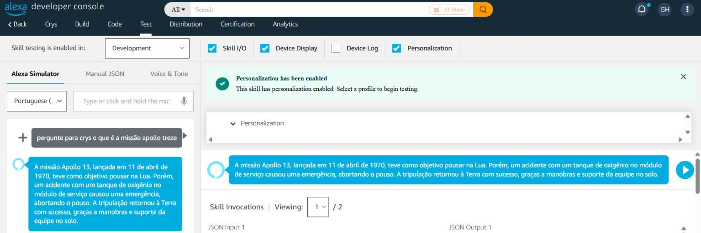

# Crys e Alexa

> “Pergunte para Crys o que é a missão Apollo treze.”

*Teste no simulador da Alexa em 03/11/2026. A imagem mostra a pergunta e a resposta devolvida pela integração; o recorte exclui os identificadores técnicos da conta e da skill.*

[English](README.en.md) · [Portfólio](https://github.com/EagleKhan0505)

Minha intenção com a Crys é poder conversar com uma assistente de IA pela Alexa, em português. Para isso, conectei uma skill da Alexa à API da OpenAI. A entrada vem da interação por voz, a integração trata a pergunta e a Alexa apresenta a resposta em seu próprio fluxo.

## O desafio aparece quando a resposta precisa ser falada

Uma conversa por voz tem um ritmo diferente. Uma resposta extensa fica cansativa de ouvir; uma consulta demorada pode ultrapassar o tempo que a Alexa permite esperar. O trabalho envolveu ajustar a integração a essas condições, com instruções para respostas curtas, contexto recente da conversa e controle de tempo.

O fluxo usa a **Responses API** e inclui busca na web quando necessário. As respostas de voz priorizam concisão; as fontes podem acompanhar a resposta no cartão da Alexa. Isso separa a fala, que precisa ser simples de acompanhar, do material que pode ser consultado depois.

## O que o registro demonstra

A captura mostra uma pergunta direta sobre Apollo 13 recebendo resposta no simulador. Os registros de desenvolvimento também incluem a abertura da skill e uma consulta com busca e fontes sobre Artemis.

São testes do ambiente de desenvolvimento da Alexa. O funcionamento consistente em um Echo físico ainda não está confirmado, e revisões locais posteriores não devem ser confundidas com a versão testada no simulador.

## Escolhas da implementação

- **Interface:** skill customizada em português do Brasil, integrada ao fluxo da Alexa.
- **Conversa:** contexto curto e respostas orientadas à escuta, com limite de extensão.
- **Integração:** Node.js, Alexa Skills Kit e OpenAI Responses API.
- **Operação:** controle de prazo da requisição e credenciais separadas do conteúdo apresentado ao usuário.

Este projeto é a integração **Alexa ↔ API da OpenAI**. Não depende de acessar o histórico ou a memória de uma conta do ChatGPT. As chamadas à API seguem seus próprios custos de uso.

A apresentação pública contém o registro do teste e uma visão da solução. Código completo, credenciais e configuração da infraestrutura permanecem privados.
